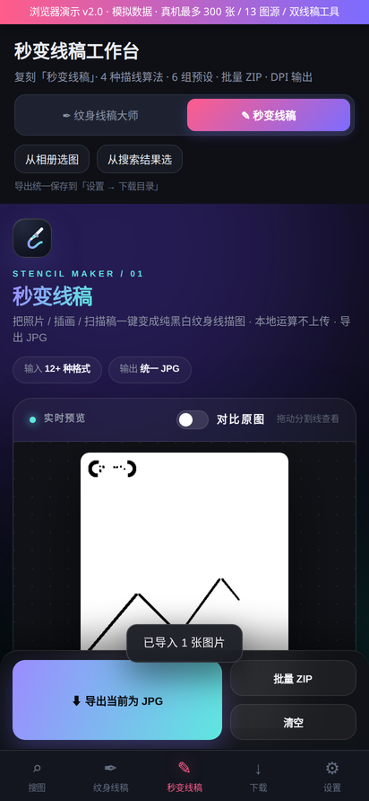

# 聚搜图库 · JuSou TuKu

一款 Android 图片聚合搜索与下载工具：输入一句话描述想要的图片，自动并发检索多个搜索引擎与图库，把结果**去重后按「热门程度 + 贴近搜索词的程度」聚合排序**，最多展示 **300 张**；支持大图查看、自定义下载目录，并**同时内置两套完整线稿工具**——「纹身线稿大师」与「秒变线稿」，想用哪个用哪个。

- **APK 约 158 KB**（v2.0.0），纯 Android framework API，无 AndroidX、无第三方 SDK、无广告、无后台上传。
- 两套线稿工具全部在本机计算，图片不会上传到任何服务器。
- 开源协议：MIT。

| 聚合搜索 | 大图查看 | 纹身线稿大师 | 秒变线稿 |
| :---: | :---: | :---: | :---: |
|  |  |  |  |

> 想先在电脑上看界面？打开仓库根目录的 [`preview.html`](preview.html)（单文件、模拟数据、两套线稿工具均可交互）。生成方式见「自行构建」。

---

## v2.0.0 更新

| 变更 | 说明 |
| --- | --- |
| 展示上限 **100 → 300** | `SearchEngine.MAX_RESULTS`、设置滑块（10～300）、每源抓取量动态化（40～60），保证去重后仍能凑满 300 张 |
| 新增「秒变线稿」完整复刻 | 原项目单文件 Web 应用原样内置，4 种描线算法、6 组预设、批量 ZIP、DPI 输出全部保留 |
| 双工具自由切换 | 底部导航两个独立入口 + 两个页面顶部的切换器；查看器新增「送纹身线稿 / 送秒变线稿」两个按钮 |
| 导出统一落盘 | 两套工具的导出都走「设置 → 下载目录」（SAF 自定义目录 / MediaStore），并写入下载记录 |
| 版本号 | `versionCode 2` / `versionName 2.0.0`，签名与 v1 一致，可直接覆盖升级 |

---

## 功能

- **多源聚合**：一次搜索并发请求 13 个来源，任一来源超时/失败不影响其它来源，界面显示每个来源的命中数与失败原因。
- **智能排序**：综合分 = `0.55 × 相关度 + 0.45 × 热门度`。可一键切换「综合推荐 / 热门优先 / 最贴题」。
  - 相关度：标题与搜索词的分词匹配（含中文 2-gram）、完整词命中、源内排名。
  - 热门度：源内排名衰减 + 图库返回的浏览/下载/点赞数 + **被多个来源同时命中的次数**。
- **去重 + 上限 300**：按规范化 URL 去重（自动忽略签名、时效等追踪参数），默认最多 300 张，可在设置里调为 10～300。每源抓取量随上限动态调整，避免「上限提高了却凑不满」。
- **看图**：全屏查看器，左右切换、双击缩放、显示来源 / 尺寸 / 授权 / 三项评分，可跳转来源网页。
- **下载目录自定义**：通过系统文件选择器指定任意目录（SAF 持久化授权），可再设子文件夹名；未指定时写入系统「下载 / 聚搜图库」。支持 Android 10+ 分区存储。
- **防盗链处理**：所有图片经应用内本地代理转发，自动附加 UA 与 Referer，并做磁盘缓存。
- **两套线稿工具**：完整复刻 [tattoo-stencil-maker](https://github.com/donghuaigu123/tattoo-stencil-maker) 与 [tattoo-stencil-studio](https://github.com/donghuaigu123/tattoo-stencil-studio)，详见下一节。
- **下载记录**：本机保存文件名、路径、时间，可随时回看。

---

## 两套线稿工具

底部导航有「纹身线稿」「秒变线稿」两个独立入口；两个工具页顶部都有切换器，一键互跳。搜索结果在查看器里可点「✒ 送纹身线稿」或「✎ 送秒变线稿」直接导入任意一个。

| | 纹身线稿大师 | 秒变线稿 |
| --- | --- | --- |
| 复刻自 | `tattoo-stencil-maker` | `tattoo-stencil-studio` |
| 实现方式 | 纯 Java 位图算法（`StencilProcessor.java`） | 纯前端 Canvas + JS（单文件 Web 应用，内嵌 pako / UTIF） |
| 描线算法 | 背景漂白 → 局部均值差分 → 多通道 Sobel → 二值化 → 去噪 | **4 种可切换**：Sobel 轮廓、自适应阈值块面、混合描边、Otsu 全局二值 |
| 预设 | 3 档（细线 / 标准 / 浓线） | **6 组**（精细线稿 / 标准纹身稿 / 简约粗线 / 黑白剪影 / 混合描边 / 海报二值） |
| 可调参数 | 线条强度、细节保留、深色背景净化 | 细节程度、亮度 / 对比度 / 伽马、线条灵敏度、平滑降噪、杂点清除、线条加粗、反色、输出尺寸、白边、JPG 质量 |
| 输出 | PNG | JPG（单张）/ **ZIP（批量）**，可写入 96 / 150 / 300 / 600 DPI |
| 批量 | 单张 | **多图队列 + 批量打包** |
| 输入格式 | JPG / PNG（经原生解码） | JPG / PNG / WebP / GIF / BMP / SVG / AVIF / TIFF / ICO（TIFF 内嵌解码） |
| 预览 | 原图 / 线稿 / 拖动分割对比 | 实时预览 + 拖动分割对比 + 滚动时常驻迷你预览 |
| 适合场景 | 快速出一张干净的纹身转印底稿 | 精细调参、批量出图、控制打印物理尺寸 |

### 怎么用

1. **选工具**：底部导航点「纹身线稿」或「秒变线稿」，任意时刻可用页顶切换器换到另一个。
2. **送图**：在搜图结果里打开查看器，点两个「送…」按钮之一；或在工具页点「选择图片 / 从相册选图 / 从搜索结果选」。
3. **导出**：两套工具的保存都统一写入「设置 → 下载目录」（自定义 SAF 目录或系统「下载 / 聚搜图库」），并出现在「下载」记录里。

### 复刻与融合方式

- **纹身线稿大师**：把原项目 `StencilProcessor.java` 原样移植（MIT，仅改包名），通过 `/api/stencil` 接入本机算法，参数与三档预设保持一致。
- **秒变线稿**：把原项目 `index.html` 原样保留为 `assets/miaobian.html`，**核心算法零改动**，只在文件头注入一段保存桥接适配层、文件尾注入一段送图监听：
  - 由 `LocalServer` 以同源 `/miaobian.html` 提供，主界面用 `<iframe>` 加载，CSS / JS 完全隔离，不会与主界面冲突，原项目的响应式布局和全部交互保持完整。
  - 保存：原项目的 `AndroidBridge.chunk / finish` 分块 → 适配层 `postMessage` → 宿主 `/api/save-image` → `DownloadManager`（自定义目录），规避 Binder 事务大小限制。
  - 选图：`WebChromeClient.onShowFileChooser` 支持多选，`content://` 复制到应用私有缓存并保留原文件名；另提供工具页顶部「从相册选图」宿主通道作为兜底。
  - 浏览器演示页：`make-preview.py` 把 `miaobian.html` 内联为 `srcdoc`，无需 Android 设备也能完整调参、导出。

---

## 安装

1. 从 [Releases](https://github.com/donghuaigu123/jusou-tuku/releases) 下载 `jusou-tuku-v2.0.0.apk`（或直接用仓库 `apk/` 目录里的文件）。
2. 在 Android 手机上点击安装；系统提示「未知来源」时允许即可。已装 v1 的用户可直接覆盖升级（签名一致）。
3. 要求 **Android 7.0（API 24）及以上**。安装后首次打开无需登录、无需授权网络之外的权限。

> 应用需要 `INTERNET` 权限用于检索图片。写公共下载目录的 `WRITE_EXTERNAL_STORAGE` 仅在 Android 9 及以下声明且生效；Android 10+ 使用 MediaStore / SAF。

---

## 支持的图片来源

| 来源 | 类型 | 是否需要 Key | 说明 |
| --- | --- | --- | --- |
| 必应图片 | 搜索引擎 | 否 | 国内自动走 `cn.bing.com`，解析 `images/async` 结果 |
| 搜狗图片 | 搜索引擎 | 否 | 解析页面内联 `__INITIAL_STATE__` |
| 360 图片 | 搜索引擎 | 否 | 解析页面内联结果数组 |
| 百度图片 | 搜索引擎 | 否 | `acjson` 接口，部分网络会触发反爬，失败自动跳过 |
| DuckDuckGo | 搜索引擎 | 否 | 两步获取 `vqd` 后请求 `i.js`，best-effort |
| Google 图片 | 搜索引擎 | 否 | HTML 抽取，可能被限流，默认关闭 |
| Openverse | 开放图库 | 否 | 聚合 Flickr / Wikimedia 等 CC 授权图片，附授权信息 |
| Wikimedia Commons | 开放图库 | 否 | MediaWiki API，附授权信息 |
| Flickr | 开放图库 | 否 | 公共 feed（按标签检索） |
| NASA 图库 | 开放图库 | 否 | NASA Images API，默认关闭 |
| Pixabay | 商业图库 | **是** | 返回浏览量/下载/点赞，热门排序最准确 |
| Pexels | 商业图库 | **是** | 官方 API |
| Unsplash | 商业图库 | **是** | 官方 API，附点赞数 |

在「设置 → 图源」里可自由开关；填入商业图库 API Key 后对应来源自动启用。Key 只保存在本机 `SharedPreferences`，不会上传。

> **重要**：除官方开放 API（Openverse / Wikimedia / Pixabay / Pexels / Unsplash / NASA）外，搜索引擎部分是**对公开网页结果的解析**，并非官方授权接口。对方改版、限流或反爬时对应来源会自动跳过，其它来源不受影响。请把失败来源当作「尽力而为」的补充。

---

## 聚合与排序怎么算

`SearchEngine.java` 是纯 Java 实现，不依赖 Android，可直接在桌面 JVM 上跑：

1. **并发抓取**：固定线程池同时请求所有启用的来源，每个来源单独超时，整体 14 秒截止。每源抓取量随目标上限在 40～60 之间动态调整（各源内部还有 20～60 的接口上限）。
2. **统一模型**：所有结果转成 `ImageItem`（标题、缩略图、原图、来源页、尺寸、授权、源内排名、原始热度）。
3. **去重**：规范化 URL（去协议、去 `x-expires` / `x-signature` / `_iz` / `from` 等追踪参数）后按 MD5 去重；重复命中会累计 `multiSourceHits`。
4. **打分**：
   - `relevance`：搜索词分词（英文按词、中文按 2-gram）与标题的加权匹配率 + 完整词命中 + 源内排名加成。
   - `popularity`：源内排名衰减 `1/(1+rank×0.075)`；若有真实热度数据则与 `log10(1+热度)` 融合；再叠加多源命中加成（最多 +0.18）。
   - `score = 0.55 × relevance + 0.45 × popularity`。
5. **排序 + 截断**：按所选模式降序，截断到设置的上限（**≤ 300**）。

前端切换排序时使用后端返回的三个分值本地重排，不重复请求网络。

---

## 下载与自定义目录

- 点「选择自定义目录」→ 系统文件选择器（SAF `ACTION_OPEN_DOCUMENT_TREE`）→ 应用申请**持久化 URI 授权**，之后所有下载直接写入该目录，Android 11+ 的分区存储限制同样适用。
- 「子文件夹名称」留空表示直接存到所选目录；填写则在目录内自动创建同名子目录。
- 未提供自定义目录时：Android 10+ 通过 `MediaStore.Downloads` 写入 `下载/聚搜图库/`，Android 9 及以下写公共下载目录。
- 若系统回收了目录授权，会自动回退到默认目录并在界面上更新显示，不会让下载失败。
- 图片下载、纹身线稿 PNG、秒变线稿的 JPG / ZIP **共用同一目录规则**。

---

## 技术架构

```
MainActivity (WebView + WebChromeClient)
   └── http://127.0.0.1:<随机端口>/     ← LocalServer（仅监听回环，校验 Host）
         ├── 静态资源  index.html / app.css / app.js / miaobian.html
         ├── GET  /miaobian.html        秒变线稿工具页（iframe 同源加载）
         ├── GET  /api/search          多源聚合（SearchEngine，上限 300）
         ├── GET  /api/img?u=...       图片代理（加 UA/Referer + 磁盘缓存，绕开防盗链）
         ├── GET  /api/download        下载到自定义目录（DownloadManager / SAF）
         ├── GET|POST /api/settings    设置与 API Key
         ├── POST /api/stencil         纹身线稿大师：调用 StencilProcessor 生成线稿
         ├── POST /api/save-image      保存线稿 PNG / 秒变线稿 JPG·ZIP
         ├── POST /api/clear-cache     清除图片缓存
         └── GET  /api/picked/*        相册选图暂存（避免 JS 桥传输大 base64）
```

**为什么用本地服务而不是 `file://` + JS 桥**：页面与 API 完全同源，没有 CORS / Mixed Content 问题；第三方图片统一代理可绕开防盗链；大图与选图走 HTTP 而非 Binder 事务，不受 1 MB 限制；`miaobian.html` 也能作为同源 iframe 加载。服务只绑定 `127.0.0.1`、端口随机、校验 Host，不对外暴露。

`Android` JS 桥仅用于少量原生能力：选择目录、选择相册图片、打开外部链接、分享、Toast、退出。秒变线稿 iframe 内的系统选图由 `WebChromeClient.onShowFileChooser` 接管。

---

## 自行构建

### 方式 A：命令行轻量构建（推荐）

需要 Android SDK 的 `platforms;android-35` 与 `build-tools;35.0.0`，以及 JDK 8+：

```bash
export ANDROID_SDK_ROOT=/path/to/android-sdk
bash scripts/build-apk.sh
# 产物：apk/jusou-tuku-v2.0.0.apk
```

脚本依次完成 `aapt2 compile/link（含 assets）→ javac → d8 → 打包 dex → zipalign → apksigner`。签名密钥生成在 `.keystore/` 并复用，因此重复构建可覆盖升级（该目录不入库）。

### 方式 B：桌面端聚合引擎集成测试

`SearchEngine` / `Json` / `Net` / `ImageItem` 都是纯 Java，可以脱离 Android 直接对真实图源跑一次搜索：

```bash
cd jusou-tuku
mkdir -p /tmp/jusou-test
javac --release 8 -encoding UTF-8 -d /tmp/jusou-test \
  app/src/main/java/com/donghuaigu/jusou/{Json,Net,ImageItem,SearchEngine}.java \
  scripts/SearchEngineTest.java
java -cp /tmp/jusou-test SearchEngineTest '纹身 线稿'
```

会打印每个来源的命中数、耗时、错误信息，以及综合排序 Top 8，并校验结果不超过 300 张。开发机实测（默认 8 源、国际源超时）：必应 35 / 搜狗 48 / 360 共 60 / 百度 60 条，**去重后 203 张**——旧版上限 100 会被截断，v2.0 可完整展示。

### 方式 C：生成浏览器演示页

```bash
python3 scripts/make-preview.py preview.html
# 打开 preview.html 即可在无 Android 设备时查看界面（模拟数据 + 两套线稿工具）
```

脚本会把 `miaobian.html` 内联为 `window.JUSOU_MIAOBIAN_HTML`，预览页以 `srcdoc` 加载，保持单文件离线可用。

---

## 项目结构

```
app/src/main/
├── java/com/donghuaigu/jusou/
│   ├── MainActivity.java        WebView 容器、目录/相册选择 JS 桥、iframe 选图
│   ├── LocalServer.java         本地 HTTP 服务与全部 /api 路由
│   ├── SearchEngine.java        13 个来源适配器 + 去重 + 打分 + 排序（纯 Java，上限 300）
│   ├── Json.java / Net.java     轻量 JSON 与 HTTP 客户端（纯 Java）
│   ├── ImageItem.java           统一结果模型（纯 Java）
│   ├── Settings.java            下载目录、图源开关、API Key、排序偏好
│   ├── DownloadManager.java     SAF 自定义目录 + MediaStore 默认目录（含 ZIP）
│   ├── StencilBridge.java       纹身线稿大师算法接入
│   └── StencilProcessor.java    移植自 tattoo-stencil-maker（MIT）
├── assets/
│   ├── index.html / app.css / app.js   主界面
│   └── miaobian.html                    秒变线稿（原项目单文件 + 融合适配层）
├── res/                         图标、主题、字符串
└── AndroidManifest.xml
scripts/
├── build-apk.sh                 轻量构建
├── make-preview.py              生成浏览器演示页
└── SearchEngineTest.java        桌面端集成测试
docs/                            图标与界面截图
apk/                             已签名可安装的 APK
```

---

## 已知限制

- 搜索引擎网页解析会随对方改版失效；百度、Google、DuckDuckGo 在部分网络下会被反爬并自动跳过。
- Openverse / Wikimedia / Flickr / Google 等国际源需要能访问相应服务；不可达时会等待超时才跳过，国内网络建议在「设置 → 图源」里只保留必应、搜狗、360、百度四个主力源以获得最快响应。
- 商业图库需自行申请免费 API Key。
- 图片防盗链无法 100% 绕过，个别图片可能加载失败（查看器会自动回退到缩略图）。
- 上限 300 是硬上限，实际展示张数取决于各源当时返回且去重后的数量；结果较少时可能不足 300 张。
- 两套线稿算法都针对「浅色载体上的深色勾线图案」设计，对照片类复杂纹理的效果取决于原图对比度。
- 极少数机型的 WebView 对 iframe 内 `<input type=file>` 回传的文件 URI 兼容性不佳；此时请用秒变线稿工具页顶部的「从相册选图」（宿主通道）导入图片。

---

## 版权与合规

- 聚合结果来自第三方公开搜索服务，**图片版权归原作者所有**。请遵守各站点的服务条款与授权要求（Openverse / Wikimedia 结果会显示授权信息），勿用于商业侵权用途。
- 本项目不托管、不缓存、不二次分发任何图片到本地以外的服务器；图片缓存仅存在于应用私有缓存目录。
- 本项目是独立的开源工具，与文中提到的任何搜索引擎或图库没有隶属或授权关系。

---

## 许可证与致谢

- 本项目：MIT License，见 [LICENSE](LICENSE)。
- 线稿工具 A：[donghuaigu123/tattoo-stencil-maker](https://github.com/donghuaigu123/tattoo-stencil-maker)（纹身线稿大师），MIT，Copyright (c) 2026 donghuaigu123。
- 线稿工具 B：[donghuaigu123/tattoo-stencil-studio](https://github.com/donghuaigu123/tattoo-stencil-studio)（秒变线稿），MIT，Copyright (c) 2026 秒变线稿 contributors；其内嵌的 [UTIF.js](https://github.com/photopea/UTIF.js) 与 [pako](https://github.com/nodeca/pako) 同为 MIT。
- 构建脚本思路参考 tattoo-stencil-maker 的轻量 `aapt2 → d8 → apksigner` 流程。
