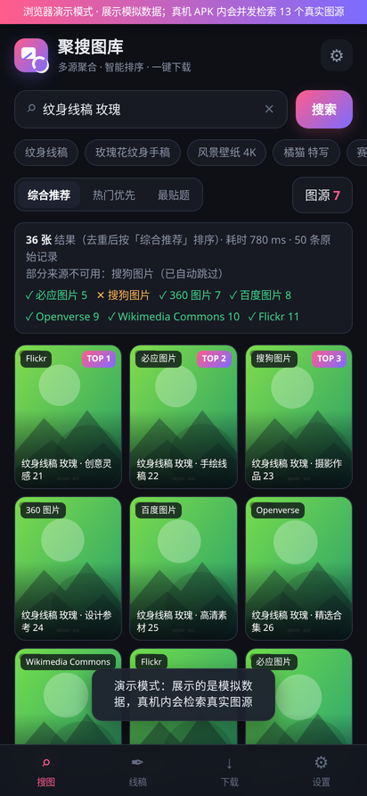
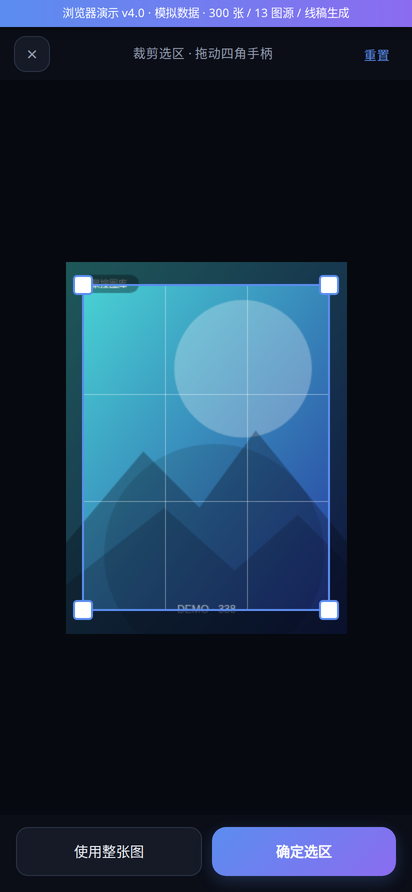

# 聚搜图库 · JuSou TuKu

一款 Android 图片聚合搜索与下载工具：输入一句话描述想要的图片，自动并发检索多个搜索引擎与图库，把结果**去重后按「热门程度 + 贴近搜索词的程度」聚合排序**，最多展示 **300 张**；支持大图查看、自定义下载目录，并**完整内置「线稿生成」**——一键把照片转成纹身级线描底稿（纯白底色 · 同尺寸对比 · 裁剪选区 · 完全离线）。

- **APK 约 117 KB**（v4.0.1），纯 Android framework API，无 AndroidX、无第三方 SDK、无广告、无后台上传。
- 线稿生成全部在本机计算，图片不会上传到任何服务器。
- 开源协议：MIT。

| 聚合搜索 | 大图查看 | 线稿生成 | 裁剪选区 | 参数设置 |
| :---: | :---: | :---: | :---: | :---: |
|  |  |  |  |  |

> 滚动设置时预览常驻效果见 [`docs/screenshot-lineart-sticky.png`](docs/screenshot-lineart-sticky.png)。

> 想先在电脑上看界面？打开仓库根目录的 [`preview.html`](preview.html)（单文件、模拟数据、线稿生成全功能可交互）。生成方式见「自行构建」。

---

## v4.0.1 更新

| 变更 | 说明 |
| --- | --- |
| **内置线稿引擎改为「线稿生成」** | 移除原先的「纹身线稿大师」「秒变线稿」「图转线稿」三套工具，改为完整复刻 [LineArt-Generator](https://github.com/donghuaigu123/LineArt-Generator)：**5 种线稿模式 × 4 个调节滑杆 × 2 个开关 + 自由裁剪选区 + 原图/线稿同尺寸拖动对比**。 |
| **UI 与配色全面美化** | 统一为深空蓝底 + 蓝紫渐变强调色，重做顶栏、导航、卡片、面板、滑杆、步骤指示器与对比控件；线稿工具页与搜索页风格完全一致。 |
| 单工具清爽入口 | 底部导航 4 项（搜图 / 线稿生成 / 下载 / 设置），查看器保留「✎ 送入线稿生成」一键送图。 |
| 滚动位置保持（延续 v3 修复） | 从搜索结果点图、传入线稿工具再返回，精确回到原位置；返回键与底部导航两条路径都生效。 |
| **滚动设置时预览常驻** | 线稿页向下滚动调节参数时，预览图自动缩为 120×120 吸顶缩略图并始终保持可见；回到顶部恢复大图，吸顶状态下「原图/线稿/对比」与拖动分割线仍可正常使用。 |
| 版本号 | `versionCode 5` / `versionName 4.0.1`，签名与 v1/v2/v3/v4 一致，可直接覆盖升级。 |

### 历史版本

- **v4.0.0**：移除三套旧线稿工具，完整复刻「线稿生成」；统一 UI 与深空蓝/蓝紫配色。
- **v3.0.0**：修复滚动位置丢失；新增「图转线稿」复刻，形成三工具切换。
- **v2.0.0**：展示上限 100 → 300（每源抓取量动态化）；新增「秒变线稿」复刻。
- **v1.0.0**：首个版本，多源聚合搜索 + 「纹身线稿大师」复刻。

---

## 功能

- **多源聚合**：一次搜索并发请求 13 个来源，任一来源超时/失败不影响其它来源，界面显示每个来源的命中数与失败原因。
- **智能排序**：综合分 = `0.55 × 相关度 + 0.45 × 热门度`。可一键切换「综合推荐 / 热门优先 / 最贴题」。
- **去重 + 上限 300**：按规范化 URL 去重，默认最多 300 张，可在设置里调为 10～300。每源抓取量随上限动态调整（40～60）。
- **看图**：全屏查看器，左右切换、双击缩放、显示来源 / 尺寸 / 授权 / 三项评分，可跳转来源网页。
- **自定义下载目录**：系统文件选择器指定任意目录（SAF 持久化授权），可再设子文件夹名；未指定时写入系统「下载 / 聚搜图库」。支持 Android 10+ 分区存储。
- **防盗链处理**：所有图片经应用内本地代理转发，自动附加 UA 与 Referer，并做磁盘缓存。
- **线稿生成**：完整复刻 LineArt-Generator，5 模式 / 4 参数 / 2 开关 / 裁剪 / 同尺寸对比，全部本机计算。
- **滚动位置保持**：搜图页与各子页的滚动位置独立记忆，来回切换不丢位置。
- **下载记录**：本机保存文件名、路径、时间，可随时回看。

---

## 线稿生成（复刻 LineArt-Generator）

完整复刻 [donghuaigu123/LineArt-Generator](https://github.com/donghuaigu123/LineArt-Generator)（MIT）。傻瓜式三步：**选图 → 裁剪选区 → 生成线稿**。

### 五种线稿模式

| 模式 | 说明 | 适用 |
| --- | --- | --- |
| **精细白描** | 细线、高细节、闭合轮廓，最接近工笔白描 | 五官、纹样等精细图案 |
| **标准线稿** | 均衡模式，线条干净、主体突出 | 大多数照片，推荐首选 |
| **粗犷轮廓** | 粗线轮廓，忽略细节 | 远观剪影、大轮廓设计 |
| **素描排线** | XDoG 算法，保留明暗排线质感 | 带明暗层次的设计稿 |
| **黑白块面** | 自适应阈值二值，亮部变黑块 | 明暗分区 / 剪影设计 |

切换模式会自动载入该模式的推荐参数。

### 调节参数

| 参数 | 范围 | 作用 |
| --- | --- | --- |
| **细节保留** | 1–100 | 越高保留越多细节，越低越平滑 |
| **线条粗细** | 0–5 | 控制线条加粗程度 |
| **线条浓度** | 1–100 | 越高线条越多越浓，越低只保留强边缘 |
| **背景净化** | 0–100 | 删除孤立小杂点、碎屑噪声 |
| **暗背景抑制** | 开 / 关 | 暗背景照片（主体亮、背景暗）推荐开启 |
| **反色输出** | 开 / 关 | 输出白线黑底，适配不同转印方式 |

所有参数滑动实时预览（防抖 450ms 自动重算）。

### 裁剪与对比

- **裁剪选区**：画布上拖动四角手柄框选，三分线辅助构图；也可「使用整张图」。裁剪框归一化后传给算法，只处理选区。
- **同尺寸对比**：原图与线稿完全等大，拖动分割线逐区查看；长按屏幕看完整原图。
- **全分辨率输出**：保存时按原图分辨率重新生成（最大边 1600px 以控制内存），纯白底 + 纯黑线 PNG，可直接用于转印打印。

### 怎么用

1. 底部导航点「线稿生成」，点「选择图片」从相册导入；或在搜图结果里打开查看器，点「✎ 送入线稿生成」。
2. （可选）点「裁剪选区」框选需要的部分，或直接用整张图。
3. 切换线稿模式、调整滑杆参数，实时预览。
4. 满意后点「保存线稿 PNG」——统一写入「设置 → 下载目录」，并出现在「下载」记录里。

### 复刻与融合方式

- 把原项目核心 `LineArtEngine.java`（纯 Java、零 Android 依赖）**原样移植**（MIT，仅改包名），新增 `LineArtGenBridge.java` 负责 base64 图片解码、可选裁剪（归一化 ROI）、1600px 缩放与 PNG 编码，通过 `/api/lineartgen` 返回线稿 data URL。
- 算法流水线：灰度化 → 可分离高斯模糊（σ 随细节自适应）→ **Canny 白描/标准/粗线**（Sobel 梯度 + 非极大值抑制 + 双阈值滞后）或 **XDoG 素描排线** 或 **积分图自适应阈值块面** → 连通域去噪（保护细线、删点状噪声）→ 形态学闭运算连接断线 → 按粗细膨胀 → 纯二值输出。
- 浏览器演示页由 `demoLineartGen()` 用 Canvas 近似同一流水线（5 模式均有效果差异），无需 Android 设备也能体验。

---

## 安装

1. 从 [Releases](https://github.com/donghuaigu123/jusou-tuku/releases) 下载 `jusou-tuku-v4.0.1.apk`（或直接用仓库 `apk/` 目录里的文件）。
2. 在 Android 手机上点击安装；系统提示「未知来源」时允许即可。已装 v1～v3 的用户可直接覆盖升级（签名一致）。
3. 要求 **Android 7.0（API 24）及以上**。安装后首次打开无需登录。

> 应用需要 `INTERNET` 权限用于检索图片。`WRITE_EXTERNAL_STORAGE` 仅在 Android 9 及以下声明且生效；Android 10+ 使用 MediaStore / SAF。

---

## 支持的图片来源

| 来源 | 类型 | 是否需要 Key |
| --- | --- | --- |
| 必应图片 / 搜狗图片 / 360 图片 / 百度图片 | 搜索引擎 | 否 |
| DuckDuckGo / Google 图片 | 搜索引擎 | 否（best-effort） |
| Openverse / Wikimedia Commons / Flickr / NASA 图库 | 开放图库 | 否 |
| Pixabay / Pexels / Unsplash | 商业图库 | **是** |

在「设置 → 图源」里可自由开关；填入商业图库 API Key 后对应来源自动启用。Key 只保存在本机 `SharedPreferences`。

> **重要**：除官方开放 API 外，搜索引擎部分是**对公开网页结果的解析**，并非官方授权接口。对方改版、限流或反爬时对应来源会自动跳过，其它来源不受影响。

---

## 聚合与排序怎么算

`SearchEngine.java` 是纯 Java 实现，不依赖 Android，可直接在桌面 JVM 上跑：并发抓取（每源单独超时，整体 14 秒截止）→ 统一 `ImageItem` 模型 → 规范化 URL 去重（累计多源命中）→ 打分（`score = 0.55 × relevance + 0.45 × popularity`）→ 排序截断到上限（**≤ 300**）。前端切换排序时用后端返回的三个分值本地重排，不重复请求网络。

---

## 下载与自定义目录

- 点「选择自定义目录」→ 系统文件选择器（SAF `ACTION_OPEN_DOCUMENT_TREE`）→ 申请**持久化 URI 授权**，之后所有下载直接写入该目录。
- 「子文件夹名称」留空表示直接存到所选目录；填写则在目录内自动创建同名子目录。
- 未提供自定义目录时：Android 10+ 通过 `MediaStore.Downloads` 写入 `下载/聚搜图库/`，Android 9 及以下写公共下载目录。
- 若系统回收了目录授权，会自动回退到默认目录并在界面上更新显示。
- 图片下载与线稿 PNG **共用同一目录规则**。

---

## 技术架构

```
MainActivity (WebView)
   └── http://127.0.0.1:<随机端口>/     ← LocalServer（仅监听回环，校验 Host）
         ├── 静态资源  index.html / app.css / app.js
         ├── GET  /api/search          多源聚合（SearchEngine，上限 300）
         ├── GET  /api/img?u=...       图片代理（UA / Referer + 磁盘缓存）
         ├── GET  /api/download        下载到自定义目录（DownloadManager / SAF）
         ├── GET|POST /api/settings    设置与 API Key
         ├── POST /api/lineartgen      线稿生成：LineArtEngine → 白底黑线 PNG（支持裁剪 ROI）
         ├── POST /api/save-image      保存线稿 PNG
         ├── POST /api/clear-cache     清除图片缓存
         └── GET  /api/picked/*        相册选图暂存（避免 JS 桥传输大 base64）
```

**为什么用本地服务**：页面与 API 完全同源，没有 CORS / Mixed Content 问题；第三方图片统一代理可绕开防盗链；大图与选图走 HTTP 而非 Binder 事务，不受 1 MB 限制。服务只绑定 `127.0.0.1`、端口随机、校验 Host。

前端滚动位置按 tab 分别记忆：搜图页用 `window.pageYOffset`，子页面用各自 `.page` 元素的 `scrollTop`，在 `switchTab` 隐藏 DOM 前保存、显示后用双 rAF 恢复。

---

## 自行构建

### 方式 A：命令行轻量构建（推荐）

需要 Android SDK 的 `platforms;android-35` 与 `build-tools;35.0.0`，以及 JDK 8+：

```bash
export ANDROID_SDK_ROOT=/path/to/android-sdk
bash scripts/build-apk.sh
# 产物：apk/jusou-tuku-v4.0.1.apk
```

脚本依次完成 `aapt2 compile/link（含 assets）→ javac → d8 → 打包 dex → zipalign → apksigner`。签名密钥生成在 `.keystore/` 并复用，因此重复构建可覆盖升级（该目录不入库）。

### 方式 B：桌面端聚合引擎集成测试

`SearchEngine` / `Json` / `Net` / `ImageItem` 都是纯 Java，可脱离 Android 对真实图源跑一次搜索：

```bash
mkdir -p /tmp/jusou-test
javac --release 8 -encoding UTF-8 -d /tmp/jusou-test \
  app/src/main/java/com/donghuaigu/jusou/{Json,Net,ImageItem,SearchEngine}.java \
  scripts/SearchEngineTest.java
java -cp /tmp/jusou-test SearchEngineTest '纹身 线稿'
```

开发机实测（默认 8 源）：必应 35 / 搜狗 48 / 360 共 60 / 百度 60 条，**去重后 203 张**，未超过 300 上限。

### 方式 C：桌面端线稿算法自测

`LineArtEngine` 是纯 Java，可用 `scripts/LineArtEngineTest.java` 验证 5 种模式、反色与 100% 纯二值输出：

```bash
mkdir -p /tmp/jusou-la
javac --release 8 -encoding UTF-8 -d /tmp/jusou-la \
  app/src/main/java/com/donghuaigu/jusou/LineArtEngine.java \
  scripts/LineArtEngineTest.java
java -Djava.awt.headless=true -cp /tmp/jusou-la LineArtEngineTest /path/to/any-color-photo.png
```

实测输出：5 种模式黑线占比 19%～30%（块面模式依图而定），其它像素 **0.00%**（纯二值），反色模式正常。

### 方式 D：生成浏览器演示页

```bash
python3 scripts/make-preview.py preview.html
# 打开 preview.html 即可在无 Android 设备时查看界面（模拟数据 + 线稿生成全功能）
```

---

## 项目结构

```
app/src/main/
├── java/com/donghuaigu/jusou/
│   ├── MainActivity.java        WebView 容器、目录/相册选择 JS 桥
│   ├── LocalServer.java         本地 HTTP 服务与全部 /api 路由
│   ├── SearchEngine.java        13 个来源适配器 + 去重 + 打分 + 排序（纯 Java，上限 300）
│   ├── Json.java / Net.java     轻量 JSON 与 HTTP 客户端（纯 Java）
│   ├── ImageItem.java           统一结果模型（纯 Java）
│   ├── Settings.java            下载目录、图源开关、API Key、排序偏好
│   ├── DownloadManager.java     SAF 自定义目录 + MediaStore 默认目录
│   ├── LineArtEngine.java       移植自 LineArt-Generator（MIT，纯 Java，5 模式）
│   └── LineArtGenBridge.java    线稿算法接入（base64 解码 / 裁剪 ROI / PNG 编码）
├── assets/
│   ├── index.html / app.css / app.js   主界面（含线稿生成工具页，统一蓝紫配色）
├── res/                         图标、主题、字符串
└── AndroidManifest.xml
scripts/
├── build-apk.sh                 轻量构建
├── make-preview.py              生成浏览器演示页
├── SearchEngineTest.java        桌面端聚合引擎集成测试
└── LineArtEngineTest.java       桌面端线稿算法自测
docs/                            图标与界面截图
apk/                             已签名可安装的 APK
```

---

## 已知限制

- 搜索引擎网页解析会随对方改版失效；百度、Google、DuckDuckGo 在部分网络下会被反爬并自动跳过。
- Openverse / Wikimedia / Flickr / Google 等国际源需要能访问相应服务；国内网络建议在「设置 → 图源」里只保留必应、搜狗、360、百度四个主力源。
- 商业图库需自行申请免费 API Key。
- 上限 300 是硬上限，实际张数取决于各源当时返回且去重后的数量。
- 线稿算法针对「浅色载体上的深色勾线图案」优化，对照片类复杂纹理的效果取决于原图对比度；默认最大边 1600px，超大图会等比缩小以控制内存。
- 浏览器演示页用 Canvas 近似 LineArtEngine 流水线，效果与真机 Java 算法不完全一致（真机为准）。

---

## 版权与合规

- 聚合结果来自第三方公开搜索服务，**图片版权归原作者所有**。请遵守各站点的服务条款与授权要求（Openverse / Wikimedia 结果会显示授权信息），勿用于商业侵权用途。
- 本项目不托管、不缓存、不二次分发任何图片到本地以外的服务器；图片缓存仅存在于应用私有缓存目录。
- 本项目是独立的开源工具，与文中提到的任何搜索引擎或图库没有隶属或授权关系。

---

## 许可证与致谢

- 本项目：MIT License，见 [LICENSE](LICENSE)。
- 线稿引擎：[donghuaigu123/LineArt-Generator](https://github.com/donghuaigu123/LineArt-Generator)（线稿生成），MIT，Copyright (c) 2026 donghuaigu123；`LineArtEngine.java` 原样移植，仅改包名。
- 构建脚本思路参考 [tattoo-stencil-maker](https://github.com/donghuaigu123/tattoo-stencil-maker) 的轻量 `aapt2 → d8 → apksigner` 流程。
