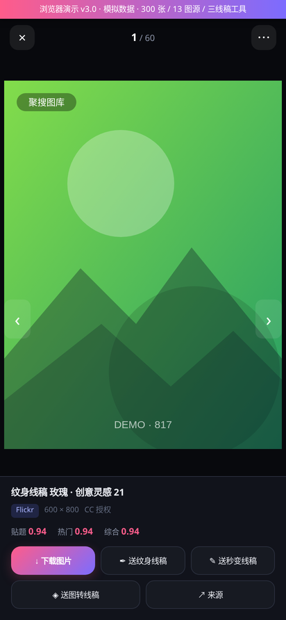
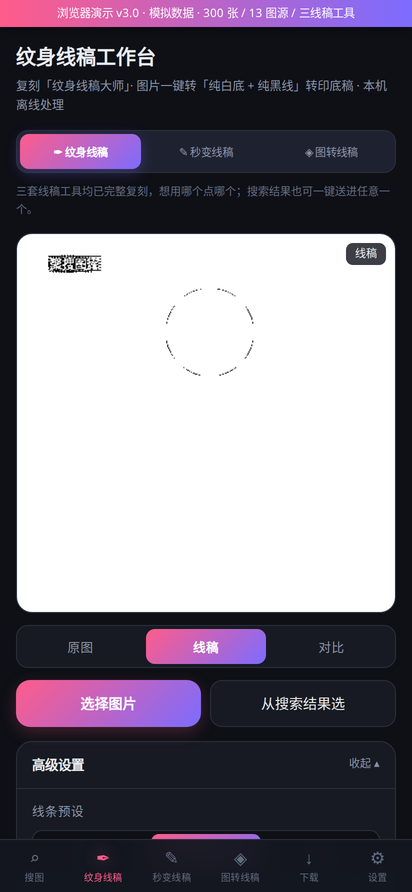
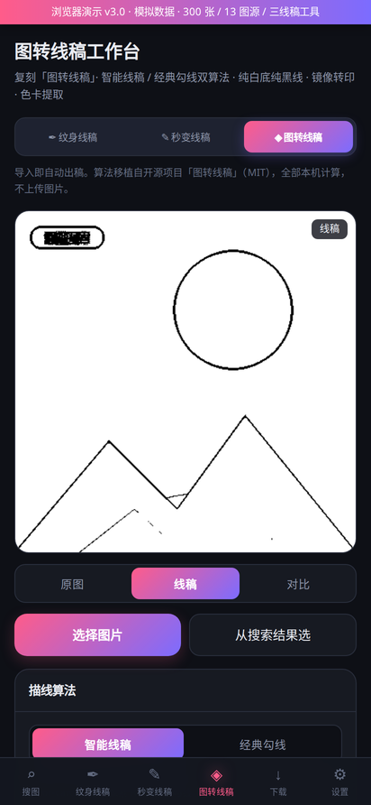
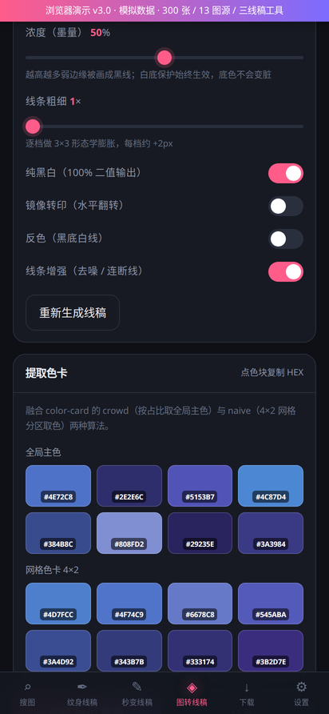

# 聚搜图库 · JuSou TuKu

一款 Android 图片聚合搜索与下载工具：输入一句话描述想要的图片，自动并发检索多个搜索引擎与图库，把结果**去重后按「热门程度 + 贴近搜索词的程度」聚合排序**，最多展示 **300 张**；支持大图查看、自定义下载目录，并**同时内置三套完整线稿工具**——「纹身线稿大师」「秒变线稿」「图转线稿」，三个独立入口，想用哪个用哪个。

- **APK 约 170 KB**（v3.0.0），纯 Android framework API，无 AndroidX、无第三方 SDK、无广告、无后台上传。
- 三套线稿工具全部在本机计算，图片不会上传到任何服务器。
- 开源协议：MIT。

| 聚合搜索 | 大图查看 | 纹身线稿大师 | 秒变线稿 | 图转线稿 |
| :---: | :---: | :---: | :---: | :---: |
|  |  |  |  |  |

> 想先在电脑上看界面？打开仓库根目录的 [`preview.html`](preview.html)（单文件、模拟数据、三套线稿工具均可交互）。生成方式见「自行构建」。

---

## v3.0.0 更新

| 变更 | 说明 |
| --- | --- |
| **修复滚动位置丢失** | 从搜索结果点进查看器、导入任意线稿工具后再返回，现在会**精确回到原来点击时所在的位置**，不再跳回顶部。原因是子页面 `position:fixed` 独立滚动、搜图页跟随 window 滚动，原实现切换 tab 时无条件 `scrollTo(0,0)`，且 `#app` 隐藏后浏览器会把 window 滚动强制清零。改为按 tab 分别保存/恢复滚动位置（隐藏前保存、显示后双 `requestAnimationFrame` 恢复），底部导航与 Android 返回键两条路径都生效；重新搜索时清零。 |
| 新增「图转线稿」完整复刻 | 移植 [tuzhuanxiangao](https://github.com/donghuaigu123/tuzhuanxiangao) 的纯 Java 算法，双描线算法、三档调节项、镜像转印、纯二值输出、色卡提取全部保留 |
| 三工具自由切换 | 底部导航 6 个入口（搜图 / 纹身线稿 / 秒变线稿 / 图转线稿 / 下载 / 设置），三个工具页顶部各有三选一切换器；查看器新增「◈ 送图转线稿」按钮，共三个送图入口 |
| 导出统一落盘 | 三套工具的导出都走「设置 → 下载目录」（SAF 自定义目录 / MediaStore），并写入下载记录 |
| 版本号 | `versionCode 3` / `versionName 3.0.0`，签名与 v1 / v2 一致，可直接覆盖升级 |

### v2.0.0（历史）

展示上限 100 → 300（含每源抓取量动态化）、新增「秒变线稿」完整复刻、双工具切换、导出统一落盘。

---

## 功能

- **多源聚合**：一次搜索并发请求 13 个来源，任一来源超时/失败不影响其它来源，界面显示每个来源的命中数与失败原因。
- **智能排序**：综合分 = `0.55 × 相关度 + 0.45 × 热门度`。可一键切换「综合推荐 / 热门优先 / 最贴题」。
- **去重 + 上限 300**：按规范化 URL 去重，默认最多 300 张，可在设置里调为 10～300。每源抓取量随上限动态调整（40～60）。
- **看图**：全屏查看器，左右切换、双击缩放、显示来源 / 尺寸 / 授权 / 三项评分，可跳转来源网页。
- **下载目录自定义**：系统文件选择器指定任意目录（SAF 持久化授权），可再设子文件夹名；未指定时写入系统「下载 / 聚搜图库」。支持 Android 10+ 分区存储。
- **防盗链处理**：所有图片经应用内本地代理转发，自动附加 UA 与 Referer，并做磁盘缓存。
- **三套线稿工具**：完整复刻 [tattoo-stencil-maker](https://github.com/donghuaigu123/tattoo-stencil-maker)、[tattoo-stencil-studio](https://github.com/donghuaigu123/tattoo-stencil-studio) 与 [tuzhuanxiangao](https://github.com/donghuaigu123/tuzhuanxiangao)，详见下一节。
- **滚动位置保持**：搜图页与各工具页的滚动位置独立记忆，来回切换不丢位置。
- **下载记录**：本机保存文件名、路径、时间，可随时回看。

---

## 三套线稿工具

底部导航有「纹身线稿」「秒变线稿」「图转线稿」三个独立入口；三个工具页顶部都有三选一切换器，一键互跳。搜索结果在查看器里可点「✒ 送纹身线稿」「✎ 送秒变线稿」「◈ 送图转线稿」直接导入任意一个。

| | 纹身线稿大师 | 秒变线稿 | 图转线稿 |
| --- | --- | --- | --- |
| 复刻自 | `tattoo-stencil-maker` | `tattoo-stencil-studio` | `tuzhuanxiangao` |
| 实现方式 | 纯 Java 位图算法（`StencilProcessor.java`） | 纯前端 Canvas + JS（单文件 Web 应用，内嵌 pako / UTIF） | 纯 Java 流水线（`LineArtCore.java` + `ColorCard.java`） |
| 描线算法 | 背景漂白 → 局部均值差分 → 多通道 Sobel → 二值化 → 去噪 | **4 种可切换**：Sobel 轮廓、自适应阈值块面、混合描边、Otsu 全局二值 | **2 种可切换**：智能线稿（DoG + Sobel + 色差三路融合）、经典勾线（color-card `line()` 相邻像素色距） |
| 预设 / 参数 | 3 档预设、线条强度、细节保留、深色背景净化 | 6 组预设、细节 / 亮度 / 对比度 / 伽马 / 灵敏度 / 降噪 / 加粗 / 反色 / 尺寸 / 白边 / 质量 | **灵敏度 / 浓度 / 粗细**三项独立调节，另可开关纯黑白、镜像转印、反色、线条增强 |
| 输出 | PNG | JPG（单张）/ **ZIP（批量）**，可写入 96 / 150 / 300 / 600 DPI | **纯二值 PNG**（白底黑线，100% 二值纯度），可选柔和灰阶 |
| 批量 | 单张 | **多图队列 + 批量打包** | 单张 |
| 输入格式 | JPG / PNG（经原生解码） | JPG / PNG / WebP / GIF / BMP / SVG / AVIF / TIFF / ICO | JPG / PNG（经原生解码，最大边 1600px） |
| 特色 | 快速出一张干净的转印底稿 | 精细调参、批量出图、控制打印物理尺寸 | **镜像转印**、自动色阶 + 白底保护、连通域去噪、**提取色卡**（crowd 全局主色 + naive 4×2 网格） |
| 预览 | 原图 / 线稿 / 拖动分割对比 | 实时预览 + 拖动分割对比 + 迷你预览 | 原图 / 线稿 / 拖动分割对比 |



### 怎么用

1. **选工具**：底部导航点三个线稿入口之一，任意时刻可用页顶切换器换到另一个。
2. **送图**：在搜图结果里打开查看器，点三个「送…」按钮之一；或在工具页点「选择图片 / 从相册选图 / 从搜索结果选」。
3. **导出**：三套工具的保存都统一写入「设置 → 下载目录」（自定义 SAF 目录或系统「下载 / 聚搜图库」），并出现在「下载」记录里。

### 复刻与融合方式

- **纹身线稿大师**：把原项目 `StencilProcessor.java` 原样移植（MIT，仅改包名），通过 `/api/stencil` 接入本机算法，参数与三档预设保持一致。
- **秒变线稿**：把原项目 `index.html` 原样保留为 `assets/miaobian.html`，**核心算法零改动**，只在文件头注入保存桥接、文件尾注入送图监听；由 `LocalServer` 以同源 `/miaobian.html` 提供，主界面用 `<iframe>` 加载，CSS / JS 完全隔离。保存走 `postMessage` → `/api/save-image` → `DownloadManager`，规避 Binder 事务大小限制。
- **图转线稿**：把原项目 `LineArtCore.java`（纯 Java、零 Android 依赖）与 `ColorCard.java` 原样移植（MIT，仅改包名），新增 `LineArtBridge.java` 负责 Bitmap ↔ `int[]` 转换、1600px 缩放与 PNG 编码，通过 `/api/lineart` 一次返回线稿 + 两组色卡。算法流水线：自动色阶 → 降噪 → DoG/Sobel/色差线强度 → Bradley 自适应二值化（含浓度偏移与白底保护）→ 去孤立点 / 连通域去噪 / 膨胀加粗 / 填孔连断线 → 纯二值输出。
- **浏览器演示页**：`make-preview.py` 把 `miaobian.html` 内联为 `srcdoc`；「图转线稿」在演示模式下由 `demoLineArt()` 用 Canvas 近似同一流水线，无需 Android 设备也能调参、看色卡、导出。

---

## 安装

1. 从 [Releases](https://github.com/donghuaigu123/jusou-tuku/releases) 下载 `jusou-tuku-v3.0.0.apk`（或直接用仓库 `apk/` 目录里的文件）。
2. 在 Android 手机上点击安装；系统提示「未知来源」时允许即可。已装 v1 / v2 的用户可直接覆盖升级（签名一致）。
3. 要求 **Android 7.0（API 24）及以上**。安装后首次打开无需登录。

> 应用需要 `INTERNET` 权限用于检索图片。`WRITE_EXTERNAL_STORAGE` 仅在 Android 9 及以下声明且生效；Android 10+ 使用 MediaStore / SAF。

---

## 支持的图片来源

| 来源 | 类型 | 是否需要 Key |
| --- | --- | --- |
| 必应图片 / 搜狗图片 / 360 图片 / 百度图片 | 搜索引擎 | 否 |
| DuckDuckGo / Google 图片 | 搜索引擎 | 否（best-effort） |
| Openverse / Wikimedia Commons / Flickr / NASA 图库 | 开放图库 | 否 |
| Pixabay / Pexels / Unsplash | 商业图库 | **是** |

在「设置 → 图源」里可自由开关；填入商业图库 API Key 后对应来源自动启用。Key 只保存在本机 `SharedPreferences`。

> **重要**：除官方开放 API 外，搜索引擎部分是**对公开网页结果的解析**，并非官方授权接口。对方改版、限流或反爬时对应来源会自动跳过，其它来源不受影响。

---

## 聚合与排序怎么算

`SearchEngine.java` 是纯 Java 实现，不依赖 Android，可直接在桌面 JVM 上跑：并发抓取（每源单独超时，整体 14 秒截止）→ 统一 `ImageItem` 模型 → 规范化 URL 去重（累计多源命中）→ 打分（`score = 0.55 × relevance + 0.45 × popularity`）→ 排序截断到上限（**≤ 300**）。前端切换排序时用后端返回的三个分值本地重排，不重复请求网络。

---

## 下载与自定义目录

- 点「选择自定义目录」→ 系统文件选择器（SAF `ACTION_OPEN_DOCUMENT_TREE`）→ 申请**持久化 URI 授权**，之后所有下载直接写入该目录。
- 「子文件夹名称」留空表示直接存到所选目录；填写则在目录内自动创建同名子目录。
- 未提供自定义目录时：Android 10+ 通过 `MediaStore.Downloads` 写入 `下载/聚搜图库/`，Android 9 及以下写公共下载目录。
- 若系统回收了目录授权，会自动回退到默认目录并在界面上更新显示。
- 图片下载、三套线稿工具的 PNG / JPG / ZIP **共用同一目录规则**。

---

## 技术架构

```
MainActivity (WebView + WebChromeClient)
   └── http://127.0.0.1:<随机端口>/     ← LocalServer（仅监听回环，校验 Host）
         ├── 静态资源  index.html / app.css / app.js / miaobian.html
         ├── GET  /miaobian.html        秒变线稿工具页（iframe 同源加载）
         ├── GET  /api/search          多源聚合（SearchEngine，上限 300）
         ├── GET  /api/img?u=...       图片代理（UA / Referer + 磁盘缓存）
         ├── GET  /api/download        下载到自定义目录（DownloadManager / SAF）
         ├── GET|POST /api/settings    设置与 API Key
         ├── POST /api/stencil         纹身线稿大师：StencilProcessor → PNG
         ├── POST /api/lineart         图转线稿：LineArtCore → 纯二值 PNG + 两组色卡
         ├── POST /api/save-image      保存线稿 PNG / 秒变线稿 JPG·ZIP
         ├── POST /api/clear-cache     清除图片缓存
         └── GET  /api/picked/*        相册选图暂存（避免 JS 桥传输大 base64）
```

**为什么用本地服务**：页面与 API 完全同源，没有 CORS / Mixed Content 问题；第三方图片统一代理可绕开防盗链；大图与选图走 HTTP 而非 Binder 事务，不受 1 MB 限制；`miaobian.html` 也能作为同源 iframe 加载。服务只绑定 `127.0.0.1`、端口随机、校验 Host。

前端滚动位置按 tab 分别记忆：搜图页用 `window.pageYOffset`，子页面用各自 `.page` 元素的 `scrollTop`，在 `switchTab` 隐藏 DOM 前保存、显示后用双 rAF 恢复。

---

## 自行构建

### 方式 A：命令行轻量构建（推荐）

需要 Android SDK 的 `platforms;android-35` 与 `build-tools;35.0.0`，以及 JDK 8+：

```bash
export ANDROID_SDK_ROOT=/path/to/android-sdk
bash scripts/build-apk.sh
# 产物：apk/jusou-tuku-v3.0.0.apk
```

脚本依次完成 `aapt2 compile/link（含 assets）→ javac → d8 → 打包 dex → zipalign → apksigner`。签名密钥生成在 `.keystore/` 并复用，因此重复构建可覆盖升级（该目录不入库）。

### 方式 B：桌面端聚合引擎集成测试

`SearchEngine` / `Json` / `Net` / `ImageItem` 都是纯 Java，可脱离 Android 对真实图源跑一次搜索：

```bash
mkdir -p /tmp/jusou-test
javac --release 8 -encoding UTF-8 -d /tmp/jusou-test \
  app/src/main/java/com/donghuaigu/jusou/{Json,Net,ImageItem,SearchEngine}.java \
  scripts/SearchEngineTest.java
java -cp /tmp/jusou-test SearchEngineTest '纹身 线稿'
```

开发机实测（默认 8 源）：必应 35 / 搜狗 48 / 360 共 60 / 百度 60 条，**去重后 203 张**，未超过 300 上限。

### 方式 C：桌面端线稿算法自测

`LineArtCore` / `ColorCard` 是纯 Java，可用 `scripts/LineArtCoreTest.java` 验证两种算法、浓度/粗细/镜像、100% 纯二值输出与色卡：

```bash
mkdir -p /tmp/jusou-la
javac --release 8 -encoding UTF-8 -d /tmp/jusou-la \
  app/src/main/java/com/donghuaigu/jusou/{LineArtCore,ColorCard}.java \
  scripts/LineArtCoreTest.java
java -cp /tmp/jusou-la LineArtCoreTest /path/to/any-color-photo.png
```

实测输出：智能线稿黑线 12.07% / 纯白底 87.93% / 其它 **0.00%**；浓度 15% → 7.97%、85% → 18.88%；镜像与加粗均生效。

### 方式 D：生成浏览器演示页

```bash
python3 scripts/make-preview.py preview.html
# 打开 preview.html 即可在无 Android 设备时查看界面（模拟数据 + 三套线稿工具）
```

---

## 项目结构

```
app/src/main/
├── java/com/donghuaigu/jusou/
│   ├── MainActivity.java        WebView 容器、目录/相册选择 JS 桥、iframe 选图
│   ├── LocalServer.java         本地 HTTP 服务与全部 /api 路由
│   ├── SearchEngine.java        13 个来源适配器 + 去重 + 打分 + 排序（纯 Java，上限 300）
│   ├── Json.java / Net.java     轻量 JSON 与 HTTP 客户端（纯 Java）
│   ├── ImageItem.java           统一结果模型（纯 Java）
│   ├── Settings.java            下载目录、图源开关、API Key、排序偏好
│   ├── DownloadManager.java     SAF 自定义目录 + MediaStore 默认目录（含 ZIP）
│   ├── StencilBridge.java       纹身线稿大师算法接入
│   ├── StencilProcessor.java    移植自 tattoo-stencil-maker（MIT）
│   ├── LineArtBridge.java       图转线稿 Bitmap 接入与色卡
│   ├── LineArtCore.java         移植自 tuzhuanxiangao（MIT，纯 Java 流水线）
│   └── ColorCard.java           移植自 tuzhuanxiangao（MIT，crowd / naive 色卡）
├── assets/
│   ├── index.html / app.css / app.js   主界面（含三套线稿工具）
│   └── miaobian.html                    秒变线稿（原项目单文件 + 融合适配层）
├── res/                         图标、主题、字符串
└── AndroidManifest.xml
scripts/
├── build-apk.sh                 轻量构建
├── make-preview.py              生成浏览器演示页
├── SearchEngineTest.java        桌面端聚合引擎集成测试
└── LineArtCoreTest.java         桌面端线稿算法自测
docs/                            图标与界面截图
apk/                             已签名可安装的 APK
```

---

## 已知限制

- 搜索引擎网页解析会随对方改版失效；百度、Google、DuckDuckGo 在部分网络下会被反爬并自动跳过。
- Openverse / Wikimedia / Flickr / Google 等国际源需要能访问相应服务；国内网络建议在「设置 → 图源」里只保留必应、搜狗、360、百度四个主力源。
- 商业图库需自行申请免费 API Key。
- 上限 300 是硬上限，实际张数取决于各源当时返回且去重后的数量。
- 三套线稿算法都针对「浅色载体上的深色勾线图案」设计，对照片类复杂纹理的效果取决于原图对比度；「图转线稿」默认最大边 1600px，超大图会等比缩小以控制内存。
- 「秒变线稿」在极少数机型的 WebView 对 iframe 内 `<input type=file>` 回传兼容性不佳；此时请用工具页顶部的「从相册选图」宿主通道导入。
- 浏览器演示页用 Canvas 近似「图转线稿」流水线，效果与真机 Java 算法不完全一致（真机为准）。

---

## 版权与合规

- 聚合结果来自第三方公开搜索服务，**图片版权归原作者所有**。请遵守各站点的服务条款与授权要求（Openverse / Wikimedia 结果会显示授权信息），勿用于商业侵权用途。
- 本项目不托管、不缓存、不二次分发任何图片到本地以外的服务器；图片缓存仅存在于应用私有缓存目录。
- 本项目是独立的开源工具，与文中提到的任何搜索引擎或图库没有隶属或授权关系。

---

## 许可证与致谢

- 本项目：MIT License，见 [LICENSE](LICENSE)。
- 线稿工具 A：[donghuaigu123/tattoo-stencil-maker](https://github.com/donghuaigu123/tattoo-stencil-maker)（纹身线稿大师），MIT，Copyright (c) 2026 donghuaigu123。
- 线稿工具 B：[donghuaigu123/tattoo-stencil-studio](https://github.com/donghuaigu123/tattoo-stencil-studio)（秒变线稿），MIT；其内嵌的 [UTIF.js](https://github.com/photopea/UTIF.js) 与 [pako](https://github.com/nodeca/pako) 同为 MIT。
- 线稿工具 C：[donghuaigu123/tuzhuanxiangao](https://github.com/donghuaigu123/tuzhuanxiangao)（图转线稿），MIT，Copyright (c) 2026 donghuaigu123；该项目自身借鉴 [image-to-line-drawing](https://github.com/luckycucu/image-to-line-drawing)（Apache-2.0）与 [color-card](https://github.com/userElaina/color-card) 的公开算法思路，未复制其源码。
- 构建脚本思路参考 tattoo-stencil-maker 的轻量 `aapt2 → d8 → apksigner` 流程。
